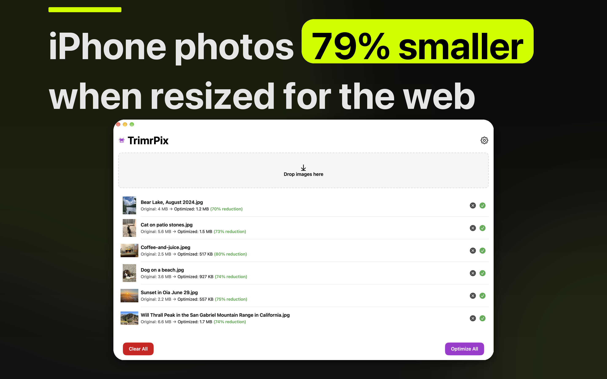

# TrimrPix

Trim file size. Keep quality.

<!-- IAMJARL README store block for TrimrPix (en). Generated from apps.json, v1.35.0. Do not edit. -->
<p>
  <a href="https://apps.apple.com/app/id6758639590?pt=128512007&amp;ct=github&amp;mt=12"><picture>
    <source media="(prefers-color-scheme: dark)" srcset="https://raw.githubusercontent.com/JarlLyng/iamjarl-design/v1.35.0/badges/mac-app-store-white-en-us.svg">
    
  </picture></a>
  <br>
  $1.99 once · macOS 15.2 or later · <a href="https://trimrpix.iamjarl.com">trimrpix.iamjarl.com</a>
</p>

<p>
  
</p>

TrimrPix makes image files smaller on your Mac without visible quality loss. Drop in one image or a few hundred, or point Watch Folder at the folder your screenshots and exports land in, and each optimized copy is saved beside its original. It takes JPEG, PNG, GIF, AVIF and HEIC, and PDFs that are images, such as scans, and strips EXIF, GPS and IPTC data on the way. It's made for anyone who puts images on the web, in decks or in email. Everything runs on your Mac: nothing is uploaded, there's no account, and you pay for it once.

## For developers

<p>
  <a href="https://madebyhuman.iamjarl.com"><picture>
    <source media="(prefers-color-scheme: dark)" srcset="https://madebyhuman.iamjarl.com/badges/co-created-white.svg">
    </picture></a>
  <a href="LICENSE"></a>
  <a href="https://github.com/JarlLyng/TrimrPix/actions/workflows/ci.yml"></a>
</p>

The developer half: what's in the app, how to build and run it, how it's put together, and how to contribute. The iPhone and iPad app is a separate project at [trimrpixforios.iamjarl.com](https://trimrpixforios.iamjarl.com).

### What's in it

- **Formats:** JPEG, PNG, GIF, AVIF and HEIC, and PDFs that are images rather than text, such as scans. A PDF with a text layer is left alone on purpose, since rasterising it would remove the text and usually make it bigger. A PDF whose text was turned into outlines has no text layer either, so it is treated like a scan and its text comes out slightly softer.
- **WebP is skipped** with a message. macOS has no WebP encoder, so TrimrPix can't make those files smaller, and Watch Folder doesn't pick them up.
- **Quality:** Low (60%), Medium (80%, the default) or High (95%), or your own from 10 to 100% in steps of 10, for JPEG, AVIF and HEIC.
- **Per format:** progressive JPEG with optimized Huffman tables; PNG quantized to 256 colors (median cut), which works best on screenshots and graphics, with the alpha channel removed where an image has no transparency; GIF re-encoded with LZW, animation kept.
- **Metadata:** EXIF, GPS and IPTC are stripped.
- **Resize:** an optional downscale to a maximum dimension before compressing. It never upscales.
- **Size guard:** if compressing would make a file bigger, the original is kept.
- **Batch:** optimize everything at once, concurrently and with progress, or one image at a time.
- **Watch Folder:** new images in a folder you choose are optimized while TrimrPix's window is open, after a wait of 0.5 to 10 seconds (2 by default), so a file still being copied is finished first.
- **Saving:** by default beside the original, with `-optimized` in its name and a number if that name is taken, or over the original if you turn that on. With auto-save off, a save dialog asks where.
- **Help menu:** Send Feedback… opens an email draft with the app and macOS versions filled in, which you see before anything is sent. TrimrPix Support opens the support page.
- **Private:** the app makes no network requests of its own. Your images never leave your Mac, and there's no account or tracking.

Requirements: macOS 15.2 or later to run it, and Xcode 26 (the macOS 26 SDK) to build it.

### Build and run

1. Clone the repo.
2. Open `TrimrPix.xcodeproj` in Xcode 26 or later.
3. Run the **TrimrPix** scheme with `⌘R`. The unit tests are the `TrimrPixTests` target: **Product → Test**, `⌘U`, or:

   ```bash
   xcodebuild test -project TrimrPix.xcodeproj -scheme TrimrPix -destination 'platform=macOS'
   ```

The app is sandboxed. Debug builds have a capture mode for the website's and the App Store's screenshots; its usage is at the top of `TrimrPix/ScreenshotMode.swift`, and Release builds don't contain it.

**Tech stack:** Swift 6 · SwiftUI · ImageIO · PDFKit · MetricKit · StoreKit · [IAMJARLDesignTokens](https://github.com/JarlLyng/iamjarl-design)

**Documentation:**

- [`AGENTS.md`](AGENTS.md): project context for developers and AI assistants.
- [`ARCHITECTURE.md`](ARCHITECTURE.md): the service layer, dependency injection, errors and logging.
- [`CODE_STYLE.md`](CODE_STYLE.md) and [`CONTRIBUTING.md`](CONTRIBUTING.md): how code is written here, and how to send a change.
- [`CHANGELOG.md`](CHANGELOG.md): what changed in each release.
- [`PRIVACY.md`](PRIVACY.md) and [`SECURITY.md`](SECURITY.md).
- [`appstore/`](appstore/): the App Store text and screenshots for each release, and how they are made.

### Contributing

Issues and pull requests are welcome. For a bigger change, open an issue first so we can talk it through. A bug report helps most with your macOS version, the steps to reproduce it, what you expected and what happened.

### Support

[support@iamjarl.com](mailto:support@iamjarl.com) for bugs, questions and ideas, or **Help → Send Feedback…** in the app. The website is [trimrpix.iamjarl.com](https://trimrpix.iamjarl.com).

### License

[MIT](LICENSE).
